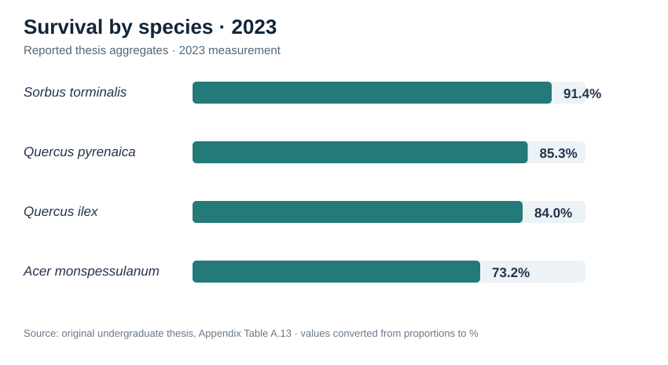
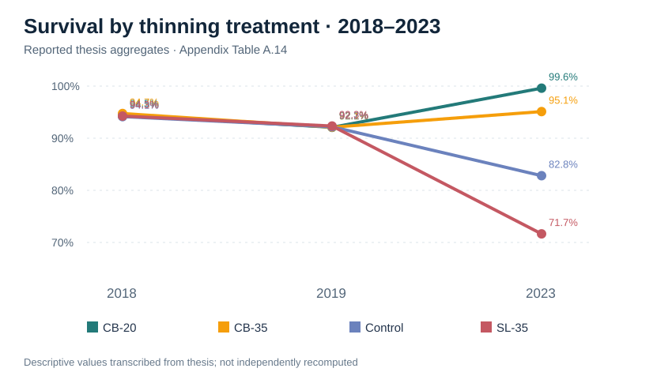
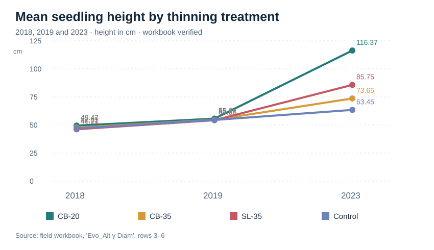

# Broadleaf Growth and Survival Under a Pine Canopy

**Understory broadleaf enrichment following thinning in a *Pinus pinaster* plantation**

Research portfolio project based on an undergraduate forestry thesis submitted at the Universidad Politécnica de Madrid (UPM). The study investigated how canopy-opening treatments relate to the survival and growth of four broadleaf species planted beneath a *Pinus pinaster* stand.

## Research question

How do thinning treatments and the resulting understory light environment affect the establishment, survival, and growth of planted broadleaf trees?

## Species and treatments

The study examined *Sorbus torminalis*, *Quercus ilex*, *Quercus pyrenaica*, and *Acer monspessulanum*. The original thesis describes an unthinned control and thinning treatments with differing types and intensities, including 20% and 35% of basal area. The study evaluated the trees five years after planting.

## Visual results from the thesis appendix





See [survival results, numeric tables, and provenance](docs/survival-results.md) and the [workbook cross-check](docs/data-audit.md). The treatment-year thesis percentages do **not** match direct counts of the available workbook rows; the chart shows thesis-reported figures only. These are descriptive thesis-reported aggregates, not newly calculated model outputs. The species ranking in Appendix Table A.13 differs from the qualitative ranking in the thesis abstract; the discrepancy is documented rather than silently reconciled.

## Mean seedling height



See [height results and source table](docs/height-results.md). The chart now follows treatment labels in the source workbook; these differ from the labels in thesis Appendix Table A.18 for Control and SL-35. The difference is documented. These are worksheet mean heights (cm), not independently recalculated growth rates.

## Findings reported in the original thesis

- Canopy thinning increased light availability in the understory.
- Greater light availability was generally associated with improved planted-tree survival and growth, with species-specific differences.
- The **CB-20%** treatment was identified as particularly effective for height growth.
- The thesis abstract describes *Quercus pyrenaica* as having the highest survival, followed by *Quercus ilex*. However, Appendix Table A.13 lists a higher 2023 aggregate for *Sorbus torminalis*; see the provenance note before interpreting species rankings.
- *Sorbus torminalis* showed a distinct response to increasing light; *Acer monspessulanum* showed comparatively little variation in survival across treatments.
- Increased light was also associated with greater growth of competing vegetation.

These are **qualitative conclusions reported in the thesis abstract**, not statistics recalculated or independently verified for this repository. No effect sizes, significance levels, or charts are invented here.

## Repository structure

```text
docs/methodology.md      Study context and evidence boundaries
docs/reproducibility.md  Reproduction status and next steps
```

## Analysis scripts

The original R scripts have been reviewed as research artifacts, **not a turnkey reproducible pipeline**. The growth script reads tabular input from the clipboard and contains a local filesystem path; the survival script includes an incomplete `glm` formula. The scripts are being held back pending review of personal paths and redistribution permissions. The analyses have not been rerun or validated against the thesis tables.

## Data availability and privacy

The original measurement workbook, raw observations, study-site identifiers and full thesis PDF are **not distributed** in this repository. Their publication or reuse should be checked for permissions and sensitivity first. This repository does not claim that the underlying study data are openly available.

## Source and attribution

Based on: Adrián Berzal Martínez, *Estudio del efecto de las claras en la supervivencia y crecimiento de cuatro especies de frondosas bajo cubierta de repoblación de Pinus pinaster Ait.*, undergraduate thesis, Universidad Politécnica de Madrid, cover dated 2023. Thesis supervisors: Juan Antonio Oliet Palá and José Luis García Pérez.

## Status

**Documentation and source-code review stage.** A full reproducibility audit, verified data dictionary, and independently regenerated results remain pending.
